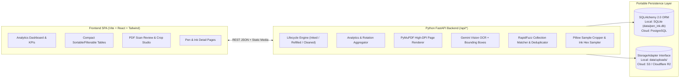
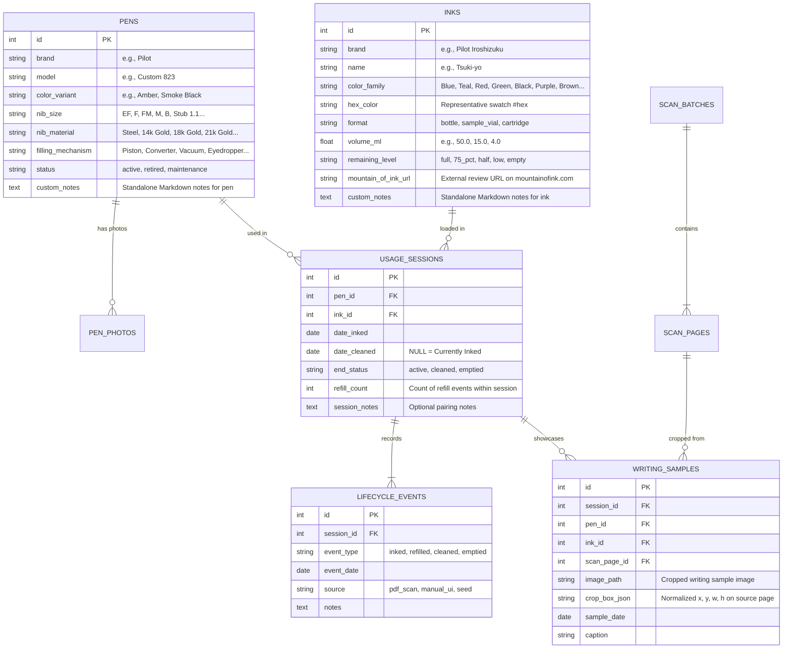

# Fountain Pen & Ink Usage Tracker — Implementation Plan

> **Saved in Workspace for Reference** (`docs/IMPLEMENTATION_PLAN.md`)
> **Selected Stack**: Python (`FastAPI` + `SQLAlchemy 2.0` + `SQLite` + `PyMuPDF` + `Pillow` + `google-genai`) + `React` (`Vite` + `TypeScript` + `Tailwind CSS` + `Recharts` + `TanStack Table`).

---

## 1. Landscape Research: Existing Fountain Pen & Ink Trackers

| Solution | Type | Core Strengths | Gaps Relative to This Project |
| :--- | :--- | :--- | :--- |
| **Fountain Pen Companion (`fpc.ink`)** | Hosted Web App | Community standard; tracks "Currently Inked", bottles vs. samples, daily usage ticks, archiving past fills, brand/color stats. | Manual data entry at every fill; no PDF notebook scan ingestion; static swab photos rather than per-fill nib writing samples. |
| **Fountain Pen Ink Journal** (iOS) & **Inkventory** (Android) | Mobile Apps | Clean "Currently Inked" views, days-inked counters, cleaning/rotation reminders, ink level badges (`Full`, `Half`, `Low`, `Empty`). | Locked to mobile silos; no desktop analytics tables or batch notebook scan cropping. |
| **Inkubator**, **Scrivn**, **penandinktracker** | Open-Source / Self-Hosted | Local privacy, relational pen-ink pairing logs, swab galleries, local DB storage. | Manual form entry only; basic UI without high-contrast SaaS analytics or PDF OCR/cropping. |
| **Notion / Airtable / Spreadsheets** | Custom Templates | Flexible tabular views, `TODAY() - Date Inked` aging formulas, custom fields (like review links). | Fragile formulas, poor image cropping UX for multi-entry notebook pages, tedious maintenance. |

### Key Differentiator
This application treats your **physical handwritten ink-up notebook as a first-class input source**—turning infrequent multi-page PDF scans into structured relational usage logs *and* cropped handwriting samples—while layering web-native actions (`Refilled`, `Cleaned`, inventory levels, standalone custom notes, and `mountainofink.com` links) on top.

---

## 2. System Architecture (Python `FastAPI` + `React/Vite/Tailwind`)

Designed to start immediately as a **personal local web app** (zero cloud dependencies, local SQLite file + local media directory) and transition seamlessly to a **cloud-hosted single-container app** (e.g., Railway, Render, Fly.io, Cloud Run) later.

### Why This Stack Excels
1. **100% Python Domain Logic**: All database models (`SQLAlchemy 2.0` + `Pydantic v2`), analytics statistics, lifecycle state transitions, fuzzy string matching (`rapidfuzz`), multi-page PDF rendering (`PyMuPDF` / `fitz`), handwriting sample cropping (`Pillow`), and Gemini Vision calls (`google-genai`) live in clean, modular Python under `backend/`.
2. **Modern Minimalist Analytics Frontend**: `React + Vite + Tailwind CSS + Recharts + Lucide` delivers a crisp, high-contrast SaaS dashboard with compact tabular numerals, sortable data tables, Light/Dark themes, and an interactive drag-and-resize bounding box crop studio under `frontend/`.
3. **Single-Server Production Mode**: When `frontend/dist` is built, `FastAPI` automatically serves both `/api/*` and the compiled SPA from a single Python process—making both daily local usage and future Docker/cloud hosting effortless.

---

## 3. Domain Data Model & Lifecycle

### Lifecycle Rules
- **Ink Up**: Opens a `UsageSession` (`end_status="active"`, `date_cleaned=None`) and logs an `inked` `LifecycleEvent`. If the pen already had an open session from an earlier date, the user can auto-close/clean the previous session on or before the new ink-up date.
- **Refill**: Logs a `refilled` `LifecycleEvent` (with selectable date defaulting to today) and increments `refill_count` while keeping the pen *Currently Inked*.
- **Clean / Empty**: Logs a `cleaned` or `emptied` `LifecycleEvent` (with selectable date defaulting to today) and closes the `UsageSession` (`date_cleaned`), moving the pairing into historical statistics.

---

## 4. Multi-Page PDF Scan Upload & Hybrid AI Vision Studio

1. **Upload Multi-Page PDF (`/scans`)**: `PyMuPDF` renders every page to crisp 200 DPI PNG/WebP images stored via `StorageAdapter`. Users can inspect/process all pages or select a specific page range.
2. **Hybrid Extraction**:
   - **With `GEMINI_API_KEY` configured**: Gemini Vision extracts 1..N entries per page (`date_inked`, `pen_brand`, `pen_model`, `nib_size`, `pen_color`, `ink_brand`, `ink_name`, and normalized `[ymin, xmin, ymax, xmax]` bounding box for the sample scribble).
   - **Manual / Offline Mode**: Works seamlessly without an API key—draw/adjust crop boxes directly on any PDF page and pick/create Pens & Inks.
3. **Fuzzy Matching & Deduplication**:
   - `rapidfuzz` matches extracted handwritten strings against your Pen Cabinet (distinguishing duplicate models by `color_variant` and `nib_size`) and Ink Library.
   - Re-scanned pages automatically detect already-imported `(pen_id, ink_id, date_inked)` entries and mark them *Already Imported — Skip*.
4. **Commit & Crop**: `Pillow` crops each confirmed sample bounding box at full page resolution and saves it linked to the `UsageSession`, `Pen`, and `Ink`.

---

## 5. Pages & Visual Analytics Summary

1. **Overview Dashboard (`/`)**:
   - KPI strip: *Currently Inked (`X / Y`)*, *Total Ink-Ups & Refills*, *Ink Inventory (`Bottles` vs `Samples`, `Low/Empty`)*, *Avg Fill Duration (Days)*, *Due for Flush (`>28d`)*.
   - **Currently Inked Command Table**: Sortable compact table with color dots, nib badges, days-inked aging indicators, sample preview, and 1-click `[+ Refill]` / `[✓ Clean]` modals (with backdate support).
   - **High-Contrast Charts**: Monthly Activity (Ink-ups / Refills / Cleanings), Most Used Pens, Most Used Inks, Color Family Collection vs. Usage Breakdown, Nib & Filling Mechanism distribution, and "Bench Warmers" (longest neglected pens & inks).
2. **Pen Cabinet (`/pens`) & Pen Detail (`/pens/:id`)**:
   - Separate **Pen Company** combobox + **Pen Name / Color** filters + multi-selectable **Pen Tags** filter (`Everyday Use`, `Collectible`, `Vintage`, `Untagged` with `Any`/`All` matching), inline & detail multi-select tag assignment, clickable sorting on every column (`Company`, `Pen Name`, `Color`, `Tags`, `Nib`, `Filling System`, `Current Status / Ink`, `Ink-Ups`, `Refills`, `Total Days`, `Last Cleaned`), photo cards, hardware specs, Pen photo upload, standalone Markdown **Custom Notes**, complete Inked/Refilled/Cleaned timeline, and all writing samples written with that pen.
3. **Ink Library (`/inks`) & Ink Detail (`/inks/:id`)**:
   - Separate **Ink Company** combobox + **Ink Name** filters, clickable sorting on every column (`Company`, `Ink Name`, `Color`, `Format`, `Size`, `Remaining Level`, `Fills`, `Days`, `Samples`, `Review Link`), 1-click inline & detail **Container Format** editing (`Bottle`, `Sample Vial`, `Cartridge`) + size/quantity editing, interactive **Remaining Level** (`Full`, `75%`, `Half`, `Low`, `Empty`), prominent **`Mountain of Ink Review ↗`** button + 1-click search helper, standalone Markdown **Custom Notes**, usage history, and nib-annotated writing sample gallery.
4. **Scan Upload & Crop Studio (`/scans`)**:
   - Multi-page PDF uploader, AI Vision auto-detect + interactive drag/resize crop overlay, ink hex eyedropper, and demo PDF included out of the box.
5. **Writing Samples Explorer (`/samples`)**:
   - Side-by-side filterable lightbox across all cropped handwriting samples by Ink, Color Family, Pen, or Nib Size.
6. **Settings & Cloud Migration Readiness (`/settings`)**:
   - Configure Gemini API key, export/backup JSON + media archive, or reset/re-seed demo data.

---

## 6. Post-Import OCR Verification, Re-Cropping & Deduplication Provisions

Because handwritten fountain pen logs span years of cursive notes, spelling variations, and two-page spreads, the application includes dedicated post-import correction tools:

1. **Verify & Correct Mode in Scan Studio (`#/scans`)**:
   - Displays all 32+ rendered notebook spreads (`100% Fit` or `185% Zoom`) alongside every imported entry on that spread.
   - Drag or resize any entry's bounding box directly on the scan spread and click **Save & Re-Crop** (`PATCH /api/samples/{id}`) to regenerate the high-DPI WebP writing sample cutout on the fly.
   - Reassign any entry's **Date Inked**, **Session Status** (`Currently Inked` vs `Cleaned` + `Date Cleaned`), **Fountain Pen** (or split into a `+ New Pen`), **Ink** (or `+ New Ink` + stroke color **Eyedropper**), and **Notes / Raw Label**—automatically syncing the linked `UsageSession` and `LifecycleEvent`s.
   - Click **+ Add Missed Entry on Spread** (`POST /api/scans/pages/{id}/entries`) to draw a bounding box for any missed entry on an already-imported scan page, or delete any false-positive entry (`DELETE /api/samples/{id}?delete_session=true`).
2. **One-Click Jump & Quick Fix from Any Writing Sample (`SampleLightbox`)**:
   - Every cropped sample across the Dashboard, Pen Detail, Ink Detail, and Samples Explorer carries its `scan_batch_id` and `scan_page_number`, offering both an inline **Correct OCR Data** form and a **Verify / Re-Crop on Scan (p.X)** deep-link button.
3. **Session Editing, Reversible Multi-Pen Merging & Session Splitting**:
   - Edit any historical or active fill session directly (`PATCH /api/sessions/{id}`).
   - **Searchable Bidirectional Merging**: Use the searchable **Merge Duplicate** modal on an individual **Pen Detail** page (`#/pens/:id`) via `POST /api/pens/merge-bulk` / `POST /api/pens/{id}/merge`. Consolidates all `UsageSession`s (usage counts, `date_inked`, `date_cleaned`, `refill_count`, `LifecycleEvent`s), `WritingSample`s, `PenPhoto`s, and `custom_notes`, while saving a reversible `PenMergeRecord` snapshot that also acts as a fuzzy OCR alias for future notebook scans.
   - **Undo Merge & Ad-Hoc Session Splitting**: Mistaken merges can be reversed in 1 click via **Undo Merge (Split Back)** (`POST /api/pens/merges/{id}/undo`), restoring the absorbed pen with its original specs, sessions, samples, and active state. Additionally, **Split Sessions** (`POST /api/pens/{id}/split`) lets users check any subset of fill sessions on a pen's timeline and split them (with their dates, events, and handwriting samples) into either a brand-new pen or another existing pen.
   - Merge duplicate Ink records (`POST /api/inks/{id}/merge`) in one click, transferring all sessions and writing samples cleanly.

---

## 7. Ratings & Standalone Notebook Tracker

1. **Pen & Ink Ratings (1–5 ★, nullable)**:
   - `pens.rating` / `inks.rating` (`INTEGER NULL`) added via additive SQLite migration in `_ensure_sqlite_schema_migrations()`.
   - Interactive `StarRating` (click a star to set, click the active star again to clear) inline on Pen Cabinet & Ink Library table rows and cards, on Pen/Ink Detail hero cards, and in the Add Pen / Add Ink modals.
   - Sortable **Rating** column (unrated always sorted last) and **Rating** filter (`All`, `5★`, `4★+`, `3★+`, `Unrated`).
   - Ratings are preserved through merges (target keeps its rating, otherwise inherits the source's) and restored on Undo Merge.
2. **Notebooks (`#/notebooks`)** — independent of pen/ink usage sessions:
   - Fields: Company, Book Name, Page Count, Binding Type, Size, Ruling, Paper Type, Paper Weight (gsm), Usage Type, Status (`in_use` / `stash` / `finished`), Start Date, Completion Date, Completion %, Rating, Notes.
   - CRUD API: `GET/POST /api/notebooks`, `PATCH/DELETE /api/notebooks/{id}`.
   - KPI strip (Total / In Use / Unused Stash / Finished / Total Pages), Company combobox + Book Name/Paper search + Status / Usage Type / Size / Rating filters, sorting on every column, inline status, completion % (auto-marks Finished at 100%) and star rating editing, Table and Cards views, Add/Edit modal.
   - Included in Settings counts and the backup ZIP JSON export.
